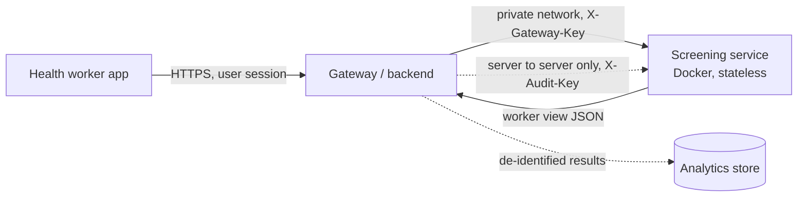
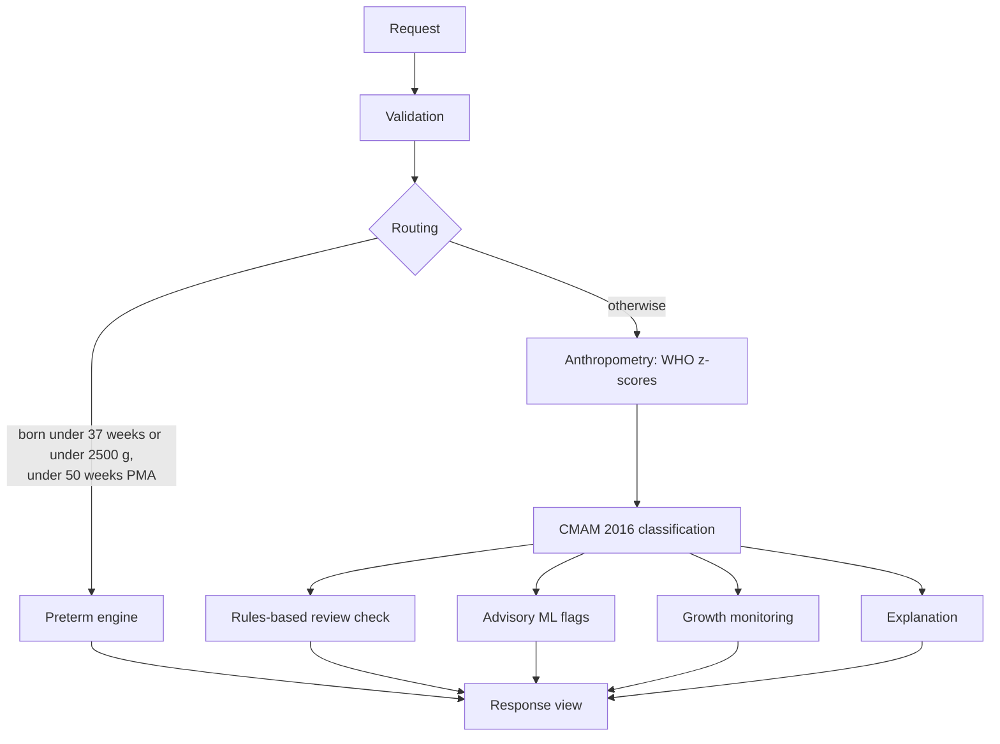

# Architecture

The screening service is a stateless calculator that sits behind a gateway. It has no database, no user accounts, no
TLS termination and no memory of any child. Identity, storage, authentication of people and exposure to the internet
belong to the gateway and the components around it.

## System context

## Responsibilities

| Concern | Screening service | Gateway / backend |
|---|---|---|
| Classify a child, advisory flags, review check | Yes | No |
| TLS and certificates | No (plain HTTP) | Yes |
| User identity, roles, sessions | No | Yes |
| Rate limiting and abuse control | No | Yes |
| Access to the service | Checks `X-Gateway-Key` (constant time, fails closed) | Holds the key in a secret store |
| Audit view | Requires a second key, `X-Audit-Key` | Server-to-server only |
| Child identity (name, ID, date of birth) | Rejected with 422 `unknown_field` | Keeps it, strips it before calling |
| Storing results and visit history | No | Yes, if required |
| Network exposure | Private network only | Isolation and firewall |

## Request flow

1. The app collects measurements and clinical findings.
2. The gateway authenticates the user, removes identifying fields and converts the date of birth to `age_days`.
3. The gateway calls `POST /v1/screen` with `X-Gateway-Key`.
4. The service validates the request and routes it (see below).
5. The service returns the worker view. The gateway renders it and stores what it needs.

Each call is independent and idempotent. A retry is safe.

## Screening pipeline

Advisory components (ML flags, review check, growth monitoring, explanation) read the result of the classification. They
never write to it. Tests assert that the classification, tier, reasons and wording are identical with and without
each of them.

## Modules

| Package | Role | Dependencies |
|---|---|---|
| `anthro` | WHO z-scores from checksummed LMS tables | standard library |
| `rules` | CMAM 2016 classification, review check | standard library |
| `preterm` | Fenton 2025 z-scores, COIN 2017 rules, routing | standard library |
| `growth` | Weight-gain velocity and z-score trends | standard library |
| `ml` | Logistic and tree recording-error flags; `ml.dl` neural network; `ml.nlp` note checker | standard library |
| `explain` | Worker summary and audit trace | standard library |
| `api`, `schemas` | HTTP service and contract | FastAPI, pydantic, uvicorn |
| `llm` | Optional local language-model client | httpx (optional extra) |
| `data` | Synthetic data generator | standard library |

Isolation rules enforced by tests: the language-model client and the note checker import nothing from the screening
code, and nothing in the screening path imports them. Only `api/app.py` and `api/service.py` import the neural-network
package.

## Views

- **Worker view** (default). Classification, tier, summary, reasons, warnings, advisory flags and versions. No HIV
  information, no referral text, and no programme for moderate cases.
- **Audit view** (`?view=audit`, both keys). Real programme, rule codes, warnings, referral text, the full explanation
  and model probabilities. May contain HIV information.

## Degraded mode

If the model files are missing or do not match the feature list, the service still starts. `/health` reports
`degraded`, screening returns the unchanged rules result, and `ml_flags.available` is `false`. The rules-based review
check and growth monitoring keep working.

## Data and licences

Reference tables ship inside the package with SHA-256 checksums in `MANIFEST.json`. Loading fails on a mismatch.
Fenton 2025 data is CC BY-NC-ND 4.0 and is shipped unmodified. See the
[reference register](references/register.md).
