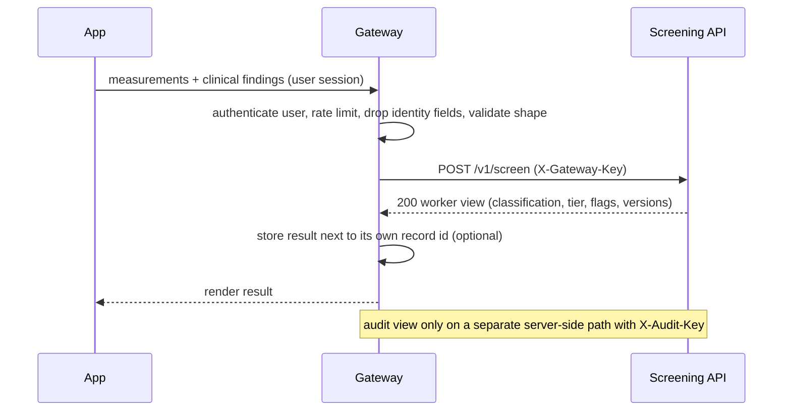

# Integration guide: connecting the screening API to the rest of the system

Technical documentation for Hope (architecture, backend, frontend, deployment, security). It explains where the screening
API sits, what it needs from its neighbours, what it gives back, and how each other component plugs in.

**What this is built from.** The contract and behaviour come from this repo (`docs/api/openapi.json`, `docs/modules/api.md`,
the specs and the runbook). The repo does not describe Hope's own stack, the dashboard or the language layer, so those
parts are written as requirements and recommendations, marked **(proposal)**. Hope decides them. Nothing here has been run
on UniPod servers or against a real front end.

Not clinically validated. Decision support only. Synthetic training data only.

## 1. The system in one picture
```mermaid
flowchart LR
    W[Health worker app<br/>Hope] -->|HTTPS, user session| G[Gateway / backend<br/>Hope]
    G -->|private network<br/>X-Gateway-Key| S[Screening API<br/>Docker, stateless]
    S -->|worker view JSON| G
    G -->|render| W
    G -.->|de-identified result record (proposal)| D[(Analytics store)]
    D --> DB[Dashboard<br/>Hope]
    G -.->|server to server only<br/>X-Audit-Key| S
    L[Local language layer<br/>NLP/AI team] -.->|translates by code| W
    M[Maria: clinical review<br/>case pack, wording] -.->|reviews wording| S
```
The screening API is a **calculator behind the gateway**. It has no database, no user accounts, no TLS, no logging of
requests and no memory of any child. Everything that involves people, identity, storage or the internet belongs to the
gateway and the components around it.

## 2. Who does what
| Concern | Screening API | Gateway / backend (Hope) |
|---|---|---|
| Classify a child (CMAM 2016 rules), flags, review check | Yes | No |
| TLS, certificates | No (plain HTTP) | Yes |
| Who the user is, roles, sessions | No | Yes |
| Rate limiting, abuse control | No | Yes |
| Access to the API | Checks `X-Gateway-Key` (constant time, fails closed) | Holds the key in a secret store |
| Audit view (`?view=audit`) | Needs a second key, `X-Audit-Key` | Only server to server. Never forward from a browser (I24) |
| Child identity (name, ID, date of birth) | **Refuses it** (422 `unknown_field`) | Keeps it. Strips it before calling |
| Storing a screening result | No (stateless) | Yes, if wanted |
| Network exposure | Private network only (I21) | Isolation, firewall |
| Logging | No bodies, no values, access lines only | Must not log bodies carelessly: they are health data |
| Wording shown to workers | English text plus stable codes | Rendering, translation (see section 7) |

## 3. Request flow

1. The app collects measurements and clinical findings.
2. The gateway authenticates the user and removes anything identifying. The API accepts `age_days` only, never a date of
   birth (the gateway converts), and rejects `name`, `child_id` and any other unknown field.
3. The gateway calls `POST /v1/screen` (worker view by default) with `X-Gateway-Key`.
4. The API returns the worker view. It carries no HIV information and no programme for MAM children (D82, D86).
5. The gateway renders it, and stores what it needs (section 8).

Each call is independent and idempotent: the same request gives the same answer, so a retry is safe.

## 4. The request
Required: `sex`, `age_days`, `weight_kg`, `length_height_cm`, `measure_position`, `oedema`. Optional clinical fields:
`muac_cm`, `appetite`, `danger_signs`, `complications`, `clinically_well_and_alert`, `hiv_positive`,
`visible_severe_wasting`, `too_weak_to_suckle`, `failure_to_gain_weight`. Optional birth context (preterm routing):
`gestational_age_weeks`, `birth_weight_g` and the preterm fields in `docs/modules/preterm.md`.

- **`null` or omitted means "not assessed". `[]` means "assessed, none present"** (D25). The front end must keep these
  apart. Never fill a missing finding with a "normal" value: the API will not, and a wrong default can hide a danger sign.
- Types are strict. Ranges and plausibility are the engine's job; the front end should still catch obvious typing slips early
  (a weight of 110 kg for a baby), because that is exactly what the recording-error flags exist for.
- Optional `previous_measurement`: `{"age_days": int, "weight_kg": number}` plus, when the gateway holds them, `"length_height_cm": number` with `"measure_position": "length" | "height"`, and `"hc_cm": number`. An earlier visit of the same child, for growth monitoring (section 7). No other keys. It must be earlier than this visit. **Every field in it must come from the same earlier visit** (the same `age_days`): never combine a weight from one visit with a head circumference from another. Send this visit's head circumference as `hc_cm` only when you also send the earlier `hc_cm` (see section 7).
- Body limit: 16 KB. One child per call. No batch.

## 5. The response and how to use it
Worker view fields: `worker_summary` (2 to 3 lines), `classification`, `tier`, `programme`, `rules_fired`, `reasons`,
`warnings`, `ml_flags`, `rule_set_version`, `model_version`, `status`, `disclaimer`, plus `route`/`birth_context` for some
babies.

| Field | Values | What the app should do |
|---|---|---|
| `classification` | `low_risk`, `MAM`, `SAM_OTP`, `SAM_INPATIENT`, `SAM_ASSESS`, `UNABLE_TO_CLASSIFY` | The result. Never override, hide or downgrade it. |
| `tier` | `low_risk`, `mam`, `urgent`, `recheck` | Drive colour and ordering. `recheck` means measure again, not "fine". |
| `worker_summary` | 2 to 3 English lines | Show as the main text. |
| `reasons[]` | `{code, message}` | Show the messages, or translate by `code` (section 7). |
| `warnings[]` | strings | Show. For MAM a neutral referral warning is always present. |
| `programme` | string, or `null` for every MAM child | Do not infer a programme when null. |
| `ml_flags` | see below | Advisory prompts to recheck. |
| `growth_monitoring` | optional object | Only when `previous_measurement` was sent. Advisory weight-gain check and z-score trends, with `review_suggested` (section 7). |
| `status`, `disclaimer` | fixed text | Must stay visible with the result. |
| `*_version` | strings | Store with every result (section 8). |

**`ml_flags`**
- `available` false means degraded mode: rules result only. The app must still work.
- `recording_error` and `deep_recording_error` (optional): `{flagged, suggested_field, messages}`. `suggested_field` is one of
  `weight`, `length_height`, `muac`, `age`. Both are advisory "please recheck" prompts. Neither changes the classification.
- `review`: `{needed, reasons[]}`. A rules-based "a person should look again" signal. It is separate from the ML flags
  and always present.
- Show `probability` never: it exists only in the audit view.

The same recheck message text is used by both ML flags, so when both flag the same field show it once. If only one flags,
show the recheck message (proposal for I58, to be confirmed by Maria and Edison). Never show reassurance such as "no errors
found" because the flags are quiet.

**Audit view** (`?view=audit`, both keys): real programme, real rule codes, `referral_text`, the full explanation and
probabilities. It can contain HIV information. Use it only for server-side audit, review and research, with its own access
control. Never put it in a browser response or a shared log.

## 6. Failure handling
| Status | Meaning | Gateway action |
|---|---|---|
| 200 | Screened | Render. |
| 401 `unauthorised` | Missing or wrong gateway key | Configuration fault. Alert, do not retry in a loop. |
| 403 `audit_forbidden` | Audit key wrong or audit off | Do not fall back to the worker view silently for an audit task. |
| 413 `payload_too_large` | Body over 16 KB | Bug in the caller. |
| 422 (`invalid_input`, `missing_field`, `unknown_field`, `invalid_request`, `invalid_json`) | The data is wrong. The message never echoes the values | Show the worker a "check the entries" message. Do not retry unchanged. |
| 500 `internal_error` | Generic, no detail | Retry once. If it persists, alert, and show the worker "could not screen, use the paper CMAM chart". |
| Timeout or no connection | Service down | Same fallback as 500. The app needs an offline or manual path: the API is not a safety net on its own. |

Measured on one 2.1 GHz vCPU (not UniPod): median about 2 ms single client, about 20 ms at 16 concurrent clients. A 2 to
5 second client timeout is generous (proposal). Repeat the measurement on UniPod hardware (`scripts/load_probe.py`).

Health: `GET /health` needs no key and returns `ok` or `degraded` (the logistic models). Alert on `degraded` and on repeated
5xx. Check versions with `GET /v1/about` (or `GET /version`): `api_version`, `engine_version`, `rule_set_version`, and the
`model_version` and `deep_model_version` of the ML components (`deep_model_version` is null on `/version` when off).

### Monitoring and "about" information (the gateway should GET it)
The gateway should poll the read-only endpoints below on a schedule, keep the latest answer, and use it for alerting and for an
admin "About" page in Hope's dashboard. None of these calls carries a child's data.

| What the gateway needs | Call | Key | Gives |
|---|---|---|---|
| Is it up (container and load-balancer check) | `GET /health` | none | `ok` or `degraded` only |
| About: versions and every component in one answer | `GET /v1/about` | `X-Gateway-Key` | `api_version`, `engine_version`, `rule_set_version`, `status`, `disclaimer`, `health`, `uptime_seconds`, `routes`, and `components` |
| Monitoring parameters: counts and timings | `GET /v1/metrics` | `X-Gateway-Key` | `since`, `uptime_seconds`, `requests_total`, `server_errors`, `by_route`, `by_status`, `screen_latency` (`p50_ms`, `p95_ms`, `max_ms`, `mean_ms`) |
| Live state of the optional LLM service | `GET /v1/llm/health` | `X-Gateway-Key` | `state`, `provider`, `model`, `detail`, `model_available`, `latency_ms` |
| Versions only (older, still available) | `GET /version` | `X-Gateway-Key` | The same version fields as `/v1/about`, plus `model_version` and `deep_model_version` |

`/v1/about` lists five `components`, each with `name`, `state`, `version` and `detail`:

| Component | `state` values | Notes |
|---|---|---|
| `screening_engine` | `ok` | The CMAM 2016 rules, the preterm engine and the corrected-age route. Never depends on the ML models. `version` is the rule set. |
| `ml_logistic` | `ok`, `degraded` | The advisory recording-error flag. `degraded` means the model files are missing or mismatched. Screening still returns the rules result. |
| `ml_deep` | `ok`, `off` | The second advisory flag. `off` means switched off or its files are missing. Screening is unaffected. |
| `growth_monitoring` | `ok` | Advisory weight-gain and z-score trends. Needs `previous_measurement`. |
| `llm_service` | `ok`, `off` | `off` unless `THANZI_LLM_ENABLED=1`. When `ok` it only means the service is configured. `/v1/about` never calls the model server: use `GET /v1/llm/health` for the live state. |

The ML models run **inside** the screening API. There is no separate ML service or URL to poll. The ML service's state is
the `ml_logistic` and `ml_deep` components.

*What `/v1/metrics` counts.* Requests per known route (anything else is counted under `other`), responses per HTTP status
(401 and 413 refusals included), and the time `/v1/screen` took over the most recent 1000 calls. It holds counts and durations
only: never a body, a value, a client address, a key or anything about a child (D176). The numbers are kept in memory for
that process, start again from zero on restart, and each worker process counts its own requests. A read of `/v1/metrics` counts
from the next read. The gateway should store the readings over time if it wants history or charts, and work out rates
from the difference between two readings.

*Parameters worth tracking at the gateway.*
- Availability: the result of each poll of `/health` and `/v1/about`, and the time of the last success.
- `health` and each component `state` from `/v1/about`. Alert on `degraded`.
- `screen_latency.p95_ms` and `max_ms` (about 2 ms median was measured on a 2.1 GHz vCPU, so a large rise is a signal).
- `server_errors` and the rate of change of `by_status`: a rise in 401 means a key fault, a rise in 422 means a data-entry or gateway bug, a rise in 5xx means alert.
- Versions from `/v1/about`, and the time they last changed. Alert when one changes without a planned release.
- A fall in `uptime_seconds` between two readings means the service restarted, and the counters started again.
- The LLM service, when enabled: `state`, `detail` and `latency_ms` from `/v1/llm/health`.
- From the stored results (section 8), the gateway's own counts of how often each flag and `review_suggested` fires per facility (see the analytics dashboard in section 7). The API does not count these.

*Rules for these calls.* Poll every 30 to 60 seconds (proposal). Cache the answer rather than calling the API on every
page view. Send the gateway key only from the server. Show `/v1/about` and `/v1/metrics` to admins only, not on public pages.
Do not poll `/v1/screen` as a health check, because that sends a child record.

## 7. Other components
**Front end (Hope).** Generate types from `docs/api/openapi.json` rather than hand-writing them, and mark `deep_recording_error`,
`deep_model_version`, `route`, `birth_context`, `clinical_assessment` and `growth_monitoring` optional. Keep a strict schema from rejecting new
optional fields. Show `status` and `disclaimer`. Keep working when `ml_flags.available` is false.

**Growth monitoring (history).** The API stores nothing, so it cannot see a child's earlier visits. The gateway or app must
keep each child's earlier visits and send one of them as `previous_measurement`. The decisions behind this are D157 to D175 and
`docs/modules/growth.md`. What the gateway has to do:

*Which earlier visit to send*
- Choose **one** earlier visit: the most recent one that is **at least 28 days** before this visit and has a weight (D171). Under
  28 days the API answers `interval_too_short` for everything. If there is none, send nothing.
- Every field in `previous_measurement` comes from that one visit. `age_days` and `weight_kg` are required. Add
  `length_height_cm` with `measure_position` if that visit measured length, and `hc_cm` if it measured head circumference.
  If the chosen visit lacks a length or head measurement, leave those keys out. Do not borrow them from another visit.
- `measure_position` (`length` or `height`) is how that earlier visit was measured. Store it for every visit. A child measured
  lying down at one visit and standing at the next is converted by the engine, but only if you say which was which.
- `age_days` is whole days from the date of birth to the **date of measurement** (not the date the entry was typed in), computed
  the same way for this visit and the earlier one. The API never receives the date of birth.
- Units: weight in kg, length, height and head circumference in cm. (`birth_weight_g` is the one field in grams.)

*What to send for this visit*
- Length, height and position are already required. Send `hc_cm` for this visit **only when the earlier visit also has `hc_cm`**.
  A head circumference with no earlier one is not used, and the API then adds the warning "Preterm-only fields were given but this
  baby is not screened by the preterm engine: they were ignored." Do not show that warning to the worker as it stands (it is
  confusing for a healthy child). Filter it or leave `hc_cm` out.

*Reading the answer*
- `growth_monitoring` is optional and advisory. It is **absent** when the baby goes down the preterm or corrected-age route
  (a warning says so), even if you sent `previous_measurement`. Absent does not mean "growth is fine".
- Weight gain: `assessed`, `status`, `flagged`, `messages`, `reference_derived`. Trends: one entry per indicator in `trends`
  (`weight_for_age` always, `length_height_for_age` and `head_circumference_for_age` only when both visits gave them), each with
  `assessed`, `reason`, `z_previous`, `z_current`, `z_change`, `direction`, `lines_crossed`, `status_change`, `flagged`, `messages`.
- When `review_suggested` is true show `review_note` ("A clinician should review this child's growth.") and the messages of every
  flagged part. When something is not assessed show its message and do not treat it as "growth is fine".
- A child can be `low_risk` and still be flagged for growth. Show both. The flag never changes the classification, and the API
  sets no CMAM finding and triggers no referral.
- For girls aged 3 to 6 months `reference_derived` is true: say so next to the weight-gain result (D164).
- The reference, the 1.0 SD trend threshold and the wording are verified by Edison (I59, I64, I61), but the feature is not
  validated on real children, so treat a flag as a prompt, not a result to act on automatically.
- Chart the z-scores if you like. `z_previous` and `z_current` are WHO z-scores at the two visits.

*Values to translate, by code* (English message stays as the fallback)
| Field | Values |
|---|---|
| `status` (weight gain) | `below_range`, `within_range`, `above_range` |
| `reason` (weight gain) | `interval_too_short`, `implausible_weight`, `outside_reference_ages` (`reference_unverified` is reserved, not used now) |
| `trends.*.indicator` | `weight_for_age`, `length_height_for_age`, `head_circumference_for_age` |
| `trends.*.reason` | `interval_too_short`, `implausible_measurement`, `outside_reference_ages`, `oedema_weight_unreliable` |
| `trends.*.direction` | `fell`, `rose`, `steady` |
| `trends.*.status_change` | `below_minus2`, `below_minus3`, or null |

*Errors.* A bad earlier visit (same or later age, a non-positive value, a length without its `measure_position`, a key that is not
allowed) is a 422. Treat it as a data-entry or gateway bug to fix, not as a clinical result.

**Analytics dashboard (proposal).** The repo says Hope owns the dashboard, de-identification and aggregation by district,
facility and community (`docs/challenge-alignment.md`). The API returns no place and no facility: the gateway adds those from
its own session data. Aggregate from the stored worker-view fields (`classification`, `tier`, `ml_flags`, versions), not
from the audit view. Counting how often each flag, and `review_suggested`, fires per facility can reveal systematic measuring or typing problems, and
the two flags' agreement rate is a cheap health check of the models. Keep small-cell suppression and de-identification in
the dashboard layer.

**Local languages (NLP/AI team).** Do not translate free text by machine at the gateway. Translate by stable code: `classification`,
`tier`, `reasons[].code`, review codes (for example `unable_to_classify`, `implausible_value`, `near_threshold_muac`,
`near_threshold_z`, `discordant_muac_vs_wflh`; the audit view and `src/thanzi_screen/explain/messages.py` hold the
authoritative set), `suggested_field` (`weight`, `length_height`, `muac`, `age`), and the growth values listed under "Growth monitoring" above. Keep the English message as the fallback when a
code has no translation. Clinical wording in any language needs Maria's review (I18, I23).

**Optional local language model routes.** `/v1/llm/*` exists only when `THANZI_LLM_ENABLED=1`, sits behind the same gateway key, is
separate from screening, and is not part of the classification path. Model text must not reach health workers without clinician
review (`docs/modules/llm.md`). Leave it off unless a reviewed use exists.

**Clinical review (Maria).** She reviews worker wording and the case pack (`docs/testing/case-pack.xlsx`). Any wording the
gateway adds around the API output should go through her too.

**WhatsApp or other chat channels.** Dropped for privacy reasons (D32). The API assumes the gateway, not a chat channel,
is its only client.

## 8. What to store (proposal)
The API stores nothing. If the gateway stores results, treat them as health data.
- Store with each result: the gateway's own record ID, `classification`, `tier`, the flags, `rule_set_version`, `model_version`,
  `deep_model_version`, the API `api_version`, and the time. The versions let you explain an old result after a rules or model update.
- Keep the request measurements only if the product needs them, with the same protection. **Growth monitoring needs them:** it works only if the gateway keeps, for each child and visit, the measurement date, weight, length or height with `measure_position`, and head circumference if measured. Keep them with the same protection as other health data.
- The growth result (`growth_monitoring`) can be stored with the screening result like the other advisory fields. It can always be recomputed from the stored visits.
- Do not store the audit view in ordinary tables. Do not log request or response bodies at the gateway.
- Keep identity and measurements in separate stores linked by the gateway's own ID. The API never sees the link.

## 9. Security checklist (deployment work the code cannot check)
1. Private network only, no published container port (I21).
2. TLS at the gateway. The API speaks plain HTTP.
3. `THANZI_GATEWAY_KEY` (48 hex) and `THANZI_AUDIT_KEY` from a secret store. Different values. Rotate by starting a new container.
4. Do not forward `X-Audit-Key` from a browser (I24).
5. Rate limiting and per-user logging at the gateway, without bodies.
6. Never set `THANZI_DEV_MODE` in production (it opens docs routes and can drop the key requirement).
7. Read-only filesystem and no extra privileges, as in `deploy/docker-compose.example.yml`. Try it in staging first: it was not run on Docker here.

## 10. Testing the integration
1. **Smoke test** after every deploy: `python scripts/smoke_api.py --base-url http://HOST:8080 --gateway-key ... --audit-key ...` (19 checks, synthetic children only).
2. **Contract test**: validate real responses against `docs/api/openapi.json` in the gateway's CI.
3. **Edge cases to run through the app**: `UNABLE_TO_CLASSIFY` (show recheck), a MAM child (programme null, neutral wording),
   a baby under 2500 g (preterm response, `route: preterm`), a corrected-age baby (no ML flags), a weight typed 10 times too high
   (both flags fire), degraded mode (stop the models or point `THANZI_MODELS_DIR` at an empty folder), deep flag off
   (`THANZI_DEEP_ENABLED=0`), a 401 from a wrong key, and the growth cases below.
4. **Growth monitoring cases** (all with `previous_measurement`; the first is the WHO technical guide's own case, R21):
   - A boy, 548 days, 12.0 kg, 75.1 cm lying, `oedema: none`, `muac_cm` 14, `appetite` passed, no danger signs or complications,
     clinically well; earlier visit 122 days, 6.5 kg, 62.3 cm lying. Expect `classification: low_risk` and
     `growth_monitoring.review_suggested: true`, with `trends.length_height_for_age` flagged (`direction: fell`,
     `status_change: below_minus2`, `lines_crossed: [-1, -2]`) and `trends.weight_for_age` not flagged.
   - Earlier visit 20 days before: every part `interval_too_short`, `review_suggested: false`.
   - A girl aged 3 to 6 months with low gain: `reference_derived: true`.
   - `oedema: "+"`: the weight trend says `oedema_weight_unreliable`, the length trend still runs.
   - A preterm baby (`gestational_age_weeks` 33, `birth_weight_g` 1900, under 50 weeks post-menstrual age) or a corrected-age baby
     with `previous_measurement`: no `growth_monitoring`, plus the warning. (Without `gestational_age_weeks` a low birth weight
     alone does not stop growth monitoring.)
   - A length with no `measure_position` in `previous_measurement`: 422 `missing_field`.
5. **Expected classifications** for a wider set are in the case pack, with the rule and reference page cited.
6. **Load**: repeat `scripts/load_probe.py` on UniPod hardware and send Edison the numbers.

## 11. Open items
| Item | Owner |
|---|---|
| Network isolation, TLS, rate limits, hosting (I21) | Hope |
| Who holds the audit key and how it is accessed (I24) | Hope |
| Accept the new optional fields, or switch the deep flag off (I57) | Hope |
| What a worker sees when the two flags disagree (I58), and wording review (I18, I23) | Maria and Edison |
| Store each child's last weight and age (and length with its position, and head circumference, if held) and send `previous_measurement`; handle `growth_monitoring`, `trends`, `review_suggested` and the not-assessed reasons (I63, I68) | Hope |
| Send a source for corrected-age growth if trends should run for those babies (I67) | Edison |
| Poll `/health`, `/v1/about`, `/v1/metrics` and (if enabled) `/v1/llm/health`; keep the readings; alert as in section 6; show an About page to admins | Hope |
| Language layer: translation by code | NLP/AI team, with Edison's clinical input |
| UniPod server specification and expected request volume (Q5) | Hope and Edison |
| Real-data validation and fairness (I14, I15) | Needs Ministry data and Maria |

Related: `docs/modules/api.md`, `docs/deployment/runbook.md`, `docs/deployment/deep-flag-integration.md`, `docs/api/openapi.json`,
`docs/specs/phase-6-spec.md`, `docs/challenge-alignment.md`.
